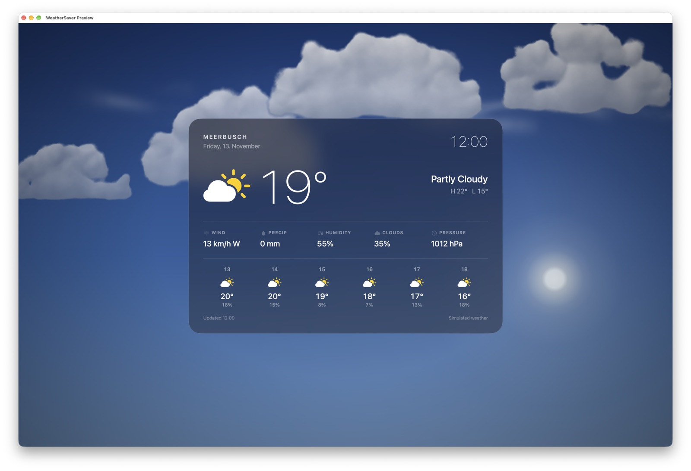

# WeatherSaver



A macOS screensaver that displays live weather conditions over a realistic, animated sky: procedurally generated clouds, rain, snow, fog and thunderstorms that follow the real time of day. Powered by weather data from the Deutscher Wetterdienst (DWD) via the [BrightSky API](https://brightsky.dev/).

## Features

- **Live weather**: Fetches current conditions and forecast from [BrightSky API](https://brightsky.dev/) (DWD data)
- **Realistic animated sky** (GPU-composited with Core Animation):
  - Procedural cumulus clouds built from lit "puffs", cloud decks, torn low clouds (fractus) and high cirrus — all drifting with the real wind direction and speed, with depth parallax
  - Rain and snow as particle systems with three depth layers, wind slant, splashes and out-of-focus foreground flakes
  - Drifting, breathing fog banks over a ground haze
  - Thunderstorms with irregular cloud flashes and branching lightning bolts
  - Day / twilight / night sky computed from the sun's elevation at your location, with stars and the current moon phase at night
- **Info card**: Frosted glass card with clock, date, SF Symbols, today's high/low, details and the next six hours; it drifts very slowly to avoid burn-in. Optionally glossy, using Liquid Glass on macOS 26+
- **Configuration panel**: Set location (latitude/longitude), location name, units (metric/imperial), animation speed, cloud opacity, update interval, and display toggles
- **Location services**: "Use Current Location" button fetches your GPS position via Core Location and reverse-geocodes it to a place name
- **Simulation mode**: Fake weather conditions (Sunny, Cloudy, Rain, Snow, Thunderstorm, Fog) for testing without API calls
- **Preview app**: Standalone macOS app to preview and configure the screensaver

## Project Structure

```
weather_saver/
├── WeatherAPI/                 # Weather data fetching layer
│   ├── BrightSkyClient.swift   # [BrightSky API](https://brightsky.dev/) client (HTTP + JSON decoding)
│   ├── LocationManager.swift   # Core Location wrapper (async/await)
│   └── WeatherTypes.swift      # Shared WeatherData model + WeatherProvider protocol
├── WeatherSaver/               # The screensaver bundle target
│   ├── Sources/
│   │   ├── ConfigurationView.swift   # SwiftUI configuration sheet
│   │   ├── WeatherPreferences.swift  # UserDefaults-backed settings (ObservableObject)
│   │   ├── WeatherSaverView.swift    # ScreenSaverView: data, scene and card orchestration
│   │   ├── WeatherScene.swift        # Core Animation sky: procedural textures, particles, lightning
│   │   ├── WeatherCardView.swift     # Frosted glass info card
│   │   ├── WeatherCondition.swift    # Condition mapping, data model, sun/moon astronomy
│   │   ├── generate_preview.swift    # Preview generation helpers
│   │   ├── preview.png                 # Screensaver thumbnail
│   │   └── thumbnail.png               # Alternative thumbnail
│   └── Support/
│       ├── Info.plist
│       └── WeatherSaver.entitlements
├── Preview/                    # Standalone preview app target
│   ├── Sources/
│   │   ├── AppDelegate.swift         # Menu bar + preferences command
│   │   ├── PreviewWindowController.swift  # Shows WeatherSaverView in a window
│   │   └── main.swift                # App entry point
│   └── Support/
│       ├── Info.plist
│       └── Preview.entitlements
├── WeatherSaver.xcodeproj/     # Xcode project (2 targets: WeatherSaver + Preview)
├── screenshot.jpg              # README screenshot
└── README.md
```

## Requirements

- macOS 14.0 or later
- Xcode 15 or later
- Internet connection (for [BrightSky API](https://brightsky.dev/))
- Location services permission (optional, for "Use Current Location")

## Building

1. Open `WeatherSaver.xcodeproj` in Xcode
2. Select the **WeatherSaver** target to build the screensaver (`.saver` bundle)
3. Select the **Preview** target to run the standalone preview app
4. Build and run

The screensaver product is `WeatherSaver.saver`. Install it by copying to `~/Library/Screen Savers/` or `/Library/Screen Savers/`, then enable it in System Settings > Desktop & Screen Saver.

### Install script

A convenience script builds and installs the screensaver in one step:

```bash
./scripts/install_screensaver.sh
```

Options:
- `./scripts/install_screensaver.sh --build-only`   Build only, do not install
- `./scripts/install_screensaver.sh --install-only` Install from an existing build

The script builds the `WeatherSaver` scheme into a local `.DerivedData/` directory, locates the `WeatherSaver.saver` bundle, and copies it to `~/Library/Screen Savers/`. After installation, open System Settings > Desktop & Screen Saver to enable WeatherSaver.

## Configuration

The configuration sheet is accessible:
- **From the screensaver**: Open System Settings > Desktop & Screen Saver > WeatherSaver > Options
- **From the Preview app**: WeatherSaver Preview ▸ Preferences… (⌘ ,)

### Settings

| Setting | Description |
|---------|-------------|
| Latitude / Longitude | Fixed coordinates for weather lookup |
| Location Name | Display name shown in the screensaver |
| Use Current Location | Fetches GPS position and reverse-geocodes a place name |
| Show Forecast | Display upcoming forecast entries |
| Show Details | Display wind, precipitation, humidity, clouds, pressure |
| Show Location Name | Show the location name in the card header |
| Use Metric Units | °C, km/h, mm, hPa (off: °F, mph, in, inHg) |
| Glossy Card | Liquid Glass info card (macOS 26+; drawn glass look on older systems) |
| Animation Speed | Slow / Normal / Fast / Very Fast |
| Cloud Opacity | Opacity multiplier for all cloud layers |
| Update Interval | How often to refresh weather data |
| Simulation Mode | Override live API with a fake condition (Sunny, Partly Cloudy, Cloudy, Overcast, Fog, Drizzle, Rain, Heavy Rain, Sleet, Snow, Heavy Snow, Thunderstorm) |

## Simulation Mode

For testing or visual preview without calling the API, enable **Simulation Mode** in the configuration panel and choose a condition. The screensaver will render the matching animation (e.g., falling snow, rain drops, fog bands, lightning flashes) with simulated temperature and conditions instead of live data.

For development, Debug builds of the Preview app also honour these environment variables, which do not touch the saved settings:

```bash
# Simulate a condition at a given local hour (sun position, day/night)
WEATHERSAVER_SIMULATE=thunderstorm WEATHERSAVER_HOUR=22 \
  .DerivedData/Build/Products/Debug/Preview.app/Contents/MacOS/Preview

# Force the glossy card on (1) or off (0)
WEATHERSAVER_GLOSSY=1 .DerivedData/Build/Products/Debug/Preview.app/Contents/MacOS/Preview
```

## Permissions

The screensaver requests:
- **Location Services** (`NSLocationWhenInUseUsageDescription`) — for "Use Current Location"
- **Network client** (`com.apple.security.network.client`) — sandbox entitlement for [BrightSky API](https://brightsky.dev/) HTTPS requests

Both entitlements are configured in `WeatherSaver/Support/WeatherSaver.entitlements`.

## License

This project is licensed under the **PolyForm Noncommercial License 1.0.0**. See the [LICENSE](LICENSE) file for full terms.

Key points:
- Noncommercial use is permitted (personal, hobby, research, education, charity, etc.)
- Commercial use requires a separate license from the copyright holder
